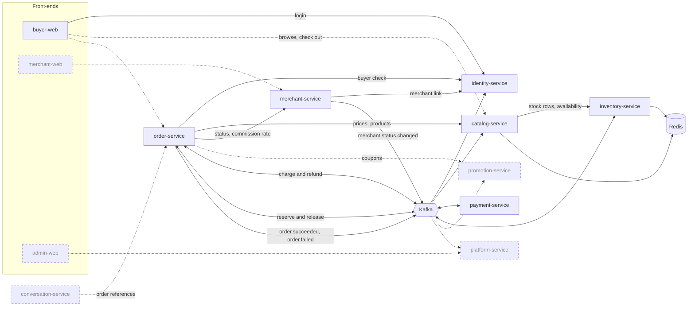
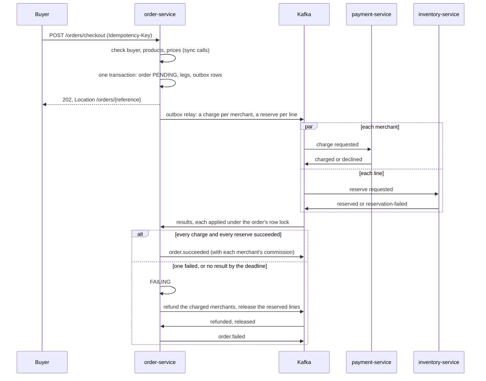

# Basketry

[](https://github.com/kevinchikwan/KevinBasketry/actions/workflows/build.yml)

A marketplace where one checkout can buy from several merchants. Each merchant
is charged separately, and stock is reserved in another service, so a single
order touches three services that share no database. The order must succeed as
a whole or not at all. order-service runs this as a saga over Kafka: it sends
the charges and reservations, collects the results, and reverses the ones that
went through when another failed. Most of the work went into the failure
paths: declines, missing stock, a service that stays down past the deadline,
and a crash in the middle of an order.

**Status:** 6 of the 9 services are built: identity, catalog, merchant,
inventory, payment and order. Promotion, conversation and platform are
designed but not built. Of the three front-ends, only `buyer-web` is started
(register, login). Kubernetes and AWS are not started. The status of each
service is in [`services/README.md`](services/README.md).

## Why I built it

I have worked on payment systems in banks for over 20 years. Basketry is where I practise the parts I cannot show from that work: an idempotent checkout, compensation when one merchant fails, and recovery when a service dies in the middle of a payment.

## Architecture



Solid boxes and arrows are built; dashed ones are planned. Every service has
its own PostgreSQL database (H2 for local runs), and every service with a
protected API checks tokens against identity-service's JWKS; both are left out
of the picture. Details and the
reasons for each split: [`docs/DESIGN.md`](docs/DESIGN.md), Section 1.

## The checkout saga



The full diagram, with the cart checks, the timer's resends and the reopen of a
failed order: [`docs/checkout-saga.mermaid`](docs/checkout-saga.mermaid).

How to read it. The checkout answers 202 before anything is charged; the buyer
polls the order. Each result arrives on its own listener thread, and each one
first locks the order's row, so exactly one result makes the decision. FAILING
means the order has failed and its charges and reservations are being reversed;
it becomes FAILED once every one is settled. A timer fails an order that has
waited too long for a result and reverses it the same way. A charge that
arrives after that is refunded, and the order is reopened until the refund is
confirmed.

## Run the demo in 10 minutes

You need Docker Desktop running, Java 25 on the `PATH`, Windows PowerShell,
about 4 GB of free memory, and ports 8080 to 8085, 9092 and 6379 free. The
scripts are PowerShell only for now. From the repo root:

```
powershell -ExecutionPolicy Bypass -File scripts\e2e-order.ps1
```

It builds the six services, starts them as real processes against Kafka and
Redis in Docker, and runs eight scenarios in about 6 minutes after the first
build (ten with `-Postgres`, about 8 minutes):

- a two-merchant order that succeeds, with the commission checked in
  `order.succeeded`, then a replay and a price change;
- a declined card, and a cart with too little stock, where both merchants are
  charged and then refunded;
- payment-service and inventory-service each stopped past the deadline, and
  what happens when they come back (with `-Postgres`, also order-service killed
  in the middle of an order).

It ends like this (a `-Postgres` run):

```
PASSED: every check passed in 472 s.
Consumer-group rejoin after the force-kill (scenario 9): 0.7 s (limit 50 s).
Consumer-group rejoin after the force-kill and a restart within 5 s (scenario 9b): 21.6 s (limit 50 s).
```

Every command the script sends is a command of
[`services/README.md`](services/README.md), so you can run the same steps by
hand, starting at
[Trying order-service by hand](services/README.md#trying-order-service-by-hand).

## Design decisions, and how each is proven

| Decision | Why | Proven by |
|---|---|---|
| [Transactional outbox](docs/DESIGN.md#5-event-catalog-kafka) | An order and the requests it sends are written in one transaction; a relay publishes them. Nothing is sent for an order that was rolled back, and nothing is lost if Kafka is down. | [`OutboxRelayTests`](services/order-service/src/test/java/com/basketry/order/outbox/OutboxRelayTests.java), [`KafkaRelayTests`](services/order-service/src/test/java/com/basketry/order/outbox/KafkaRelayTests.java) |
| [Idempotency-Key with a keyed fingerprint](docs/DESIGN.md#order-service) | A retried checkout returns the same order. The same key with a different body is refused. The fingerprint is an HMAC, because a plain hash of a card number can be reversed. | [`IdempotencyRaceTests`](services/order-service/src/test/java/com/basketry/order/checkout/IdempotencyRaceTests.java), [`RequestFingerprintTests`](services/order-service/src/test/java/com/basketry/order/checkout/RequestFingerprintTests.java) |
| [Saga decisions under the order's row lock](docs/DESIGN.md#order-service) | Two results committing at once would each see the other's leg as still open, and the order would never be decided. | [`SagaRaceTests`](services/order-service/src/test/java/com/basketry/order/saga/SagaRaceTests.java) (on H2 and PostgreSQL), [`DecisionAtomicityTests`](services/order-service/src/test/java/com/basketry/order/saga/DecisionAtomicityTests.java) |
| [Every result handled by its leg's state](docs/DESIGN.md#order-service) | Results repeat and arrive late. Each one is matched to its leg, and the leg's state says what it does. | [`SagaResultTableTests`](services/order-service/src/test/java/com/basketry/order/saga/SagaResultTableTests.java), [`SagaDecisionTests`](services/order-service/src/test/java/com/basketry/order/saga/SagaDecisionTests.java) |
| [Deadline, resends, then STUCK](docs/DESIGN.md#order-service) | A result that never comes cannot hold an order open for ever. An unconfirmed refund or release is sent again 3 times; then the order is shown to Admin. | [`SagaTimerTests`](services/order-service/src/test/java/com/basketry/order/saga/SagaTimerTests.java), e2e scenarios 7 and 8 |
| [Startup grace](docs/DESIGN.md#order-service) | After a restart, results already waiting in Kafka are read before the timer can fail their orders. | [`SagaGraceTests`](services/order-service/src/test/java/com/basketry/order/saga/SagaGraceTests.java), e2e scenarios 9 and 9b |
| [The card number scrubbed](docs/DESIGN.md#order-service) | It is removed from the outbox row once sent, and never logged or stored by payment-service beyond the last 4 digits. | [`CardNumberLeakTests`](services/order-service/src/test/java/com/basketry/order/checkout/CardNumberLeakTests.java), [`HttpCardNumberLeakTests`](services/order-service/src/test/java/com/basketry/order/web/HttpCardNumberLeakTests.java) and [`HttpJacksonMessageLeakTests`](services/order-service/src/test/java/com/basketry/order/web/HttpJacksonMessageLeakTests.java) (over HTTP with Spring at TRACE: every way the body can fail to parse, the number as a string in another field included), payment-service's [`CardNumberLeakTests`](services/payment-service/src/test/java/com/basketry/payment/payment/CardNumberLeakTests.java); the e2e script searches every log and, with `-Postgres`, a dump of both databases |
| [Strict parsing, dead-letter topics](docs/DESIGN.md#5-event-catalog-kafka) | A malformed record goes to a dead-letter topic with its exact bytes, so it never blocks the records behind it. | [`ResultParserTests`](services/order-service/src/test/java/com/basketry/order/results/ResultParserTests.java), [`ResultListenerKafkaTests`](services/order-service/src/test/java/com/basketry/order/results/ResultListenerKafkaTests.java), e2e scenario 6 |

Many tests name a mutation in their comment: a small, deliberate bug, such as
a lock removed or a state check widened, that the test must catch. The commit
messages record which mutations were applied and that each was caught. The
end-to-end scripts
([`scripts/`](scripts)) run the same paths against real processes and a real
broker.

## Known limitations

- **The card number is on the charge topic.** It stays on the charge request
  topic and payment-service's dead-letter topic for 7 days, and in
  PostgreSQL's write-ahead log until it is recycled. A real system would send a
  token. ([DESIGN Section 6](docs/DESIGN.md#6-open-questions-for-implementation))
- **Tokens have no `iss` or `aud` claim**, so a service accepts any token
  signed by identity-service's key.
  ([DESIGN Section 6](docs/DESIGN.md#6-open-questions-for-implementation))
- **The seeded admin's email and password are public** in this repository
  (`V2__seed_initial_admin.sql`). They must be replaced before deploying
  anywhere. ([DESIGN Section 7](docs/DESIGN.md#deployment-shape))
- **A stock adjustment is a delta**, so a client that retries one after a lost
  response applies it twice.
  ([DESIGN Section 6](docs/DESIGN.md#6-open-questions-for-implementation))
- **Results that lag longer than the deadline fail a healthy order.** If
  order-service's listeners fall behind by more than the deadline without a
  restart, the order is failed and reversed although every leg may have
  succeeded. ([DESIGN Section 6](docs/DESIGN.md#6-open-questions-for-implementation))
- **One Kafka broker.** Every topic has replication factor 1, locally and in
  the planned single-node deployment.
  ([DESIGN Section 5](docs/DESIGN.md#5-event-catalog-kafka),
  [Section 7](docs/DESIGN.md#deployment-shape))
- **`merchant.status.changed` keeps the default 7-day retention.** A consumer
  that starts later never sees an older deactivation; the fix
  (`cleanup.policy=compact`) is listed for deployment.
  ([DESIGN Section 6](docs/DESIGN.md#6-open-questions-for-implementation))
- **Payment is a deterministic mock.** The outcome depends only on the card
  number, so one merchant declining while another is charged can only be shown
  in tests, not live.
  ([DESIGN Section 2](docs/DESIGN.md#payment-service))
- **In local development, identity-service makes a new signing key on every
  restart**; tokens signed with the old key then get 401.
  ([DESIGN Section 3](docs/DESIGN.md#3-api-contracts-representative-endpoints))

What the design leaves out on purpose:
[DESIGN Section 7](docs/DESIGN.md#what-this-deliberately-does-not-include).

## What I would do differently

- I would start the end-to-end script with the first consumer. It found a bug
  that the unit tests and my own review missed: order-service's six listeners
  were six consumer groups instead of one.
- The scripts are PowerShell only. I would write them to run on Linux and macOS
  too.
- I would set up CI on day one. The default build needs no Docker, so there was
  no reason to wait. It is there now: the default build runs on every push.

## Stack

**Built with:** Java 25, Spring Boot 4.1, Apache Kafka 4.2 (KRaft), Redis 8,
PostgreSQL 17 (H2 for local runs and the default tests), Testcontainers, Gradle,
GitHub Actions (the default build).

**Planned:** the Merchant and Admin front-ends (React and TypeScript), k3s on
one AWS EC2 instance.

## Read next

- [`docs/REQUIREMENTS.md`](docs/REQUIREMENTS.md): what the system must do, and
  the decisions behind it (all-or-nothing checkout, commission, coupons).
- [`docs/DESIGN.md`](docs/DESIGN.md): services, data, API contracts, events,
  the saga in detail.
- [`services/README.md`](services/README.md): how to run each service, the
  status table, and the end-to-end scripts.
- [`docs/checkout-saga.mermaid`](docs/checkout-saga.mermaid): the full saga
  diagram.
- [`docs/ROADMAP.md`](docs/ROADMAP.md): what is built and what is next.

## License

MIT, see [`LICENSE`](LICENSE).
